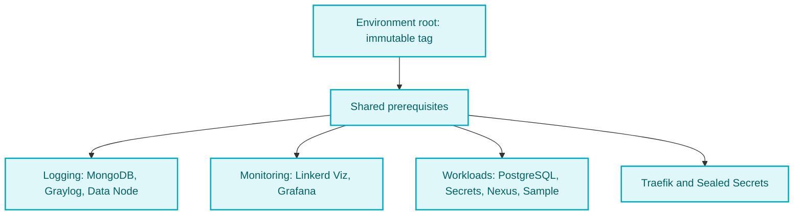

# DRN-Project Argo CD GitOps

[](https://github.com/duranserkan/DRN-Project)
[](https://github.com/duranserkan/DRN-Project-Pulumi-Ops)

[](https://github.com/duranserkan/DRN-Project-Argo-CD-Gitops/actions/workflows/master.yml)
[](https://github.com/duranserkan/DRN-Project-Argo-CD-Gitops/actions/workflows/develop.yml)
[](https://hub.docker.com/u/duranserkan)
[](https://www.nuget.org/profiles/duranserkan)
[](https://github.com/tomhuang12/awesome-k8s-resources)
[](https://github.com/akuity/awesome-argo)

[](https://sonarcloud.io/summary/new_code?id=duranserkan_DRN-Project-Argo-CD-Gitops)
[](https://sonarcloud.io/summary/new_code?id=duranserkan_DRN-Project-Argo-CD-Gitops)
[](https://sonarcloud.io/summary/new_code?id=duranserkan_DRN-Project-Argo-CD-Gitops)
[](https://sonarcloud.io/summary/new_code?id=duranserkan_DRN-Project-Argo-CD-Gitops)
[](https://sonarcloud.io/summary/new_code?id=duranserkan_DRN-Project-Argo-CD-Gitops)
[](https://sonarcloud.io/summary/new_code?id=duranserkan_DRN-Project-Argo-CD-Gitops)

Deploy [DRN-Project](https://github.com/duranserkan/DRN-Project) Sample and Nexus with Argo CD, Linkerd, Traefik, PostgreSQL and Graylog. This repository owns deployment configuration. Application builds and image publishing belong to DRN-Project.

**TL;DR: You can**

- Develop and test distributed .NET applications with [DRN Framework](https://github.com/duranserkan/DRN-Project).
- Deploy Sample and Nexus to Kubernetes using Argo CD GitOps and Linkerd service mesh.
- Use Sample as a reference application and adapt this repository's deployment structure for your own services.
- Publish preview releases from `develop` and final releases from `master`, using immutable tags.
- **TODO:** Extend [Nexus App](https://hub.docker.com/r/duranserkan/drn-project-nexus) with service discovery, remote settings, a unified microservices topology view and service self-documentation.
- **TODO:** Validate Oracle Cloud provisioning and retained-data recovery with [DRN-Project Pulumi Ops](https://github.com/duranserkan/DRN-Project-Pulumi-Ops).

[About Project, Kubernetes and Argo CD](#about-project-kubernetes-and-argo-cd) | [GitOps Roadmap](#gitops-roadmap) | [Tools](#tools) | [Deployment](#deployment-model) | [Bootstrap](#bootstrap-a-cluster) | [Continuous Integration](#continuous-integration)

## About Project, Kubernetes and Argo CD

The [Distributed Reliable .Net](https://github.com/duranserkan/DRN-Project?tab=readme-ov-file#drn-project) project follows best practices without following them blindly. The result should feel satisfying and worth the effort. Its Continuous Integration setup reflects this approach to DevSecOps.

It should do the same with Continuous Deployment and Delivery. Finding a practical approach that works across many cases is hard. The solution must stay flexible and manageable. Therefore, Kubernetes is the obvious answer :)

To be honest, this project initially avoided and resisted Kubernetes. Its complexity and maintenance demands were hard to welcome. Its flexibility and sense of control were appealing, though. Despite these reservations, Kubernetes cannot be ignored. As a cloud-native standard, it helps avoid vendor lock-in.

It was puzzling, like trying to find a generalized solution for [the Navier–Stokes equations.](https://en.wikipedia.org/wiki/Navier–Stokes_equations) Therefore, the solution can also be simplified if certain reasonable assumptions can be made, similar to how all true-hearted, humble engineers solve the Navier–Stokes equations under specific conditions.

- Use managed Kubernetes
- Use managed databases or services outside of cluster for stateful data.
- Don't apply manifests and configurations by yourself and version control your changes

[Argo CD](https://argo-cd.readthedocs.io/en/stable/) handles the last point through GitOps. The first two choices help small teams keep complexity and maintenance manageable.

These are design preferences. Staging currently runs PostgreSQL and Graylog's data services inside the cluster. Production application databases are provisioned separately. Administrators still install Argo CD and apply the reviewed bootstrap and environment roots. Argo CD then manages the resources beneath those roots. The deployment guidance below explains this setup.

## Tools

High quality output is not a coincidence. It is natural result of good people's labour that works with right processes and tools.

This project recommends following tools for anyone who doesn't have strong Kubernetes experience as a starter pack.

- [kube-ps1](https://github.com/jonmosco/kube-ps1) - kube-ps1: A script that lets you add the current Kubernetes context and namespace configured on kubectl to your Bash/Zsh prompt strings (i.e. the $PS1).
- [kubectx + kubens](https://github.com/ahmetb/kubectx) - `kubectx` helps you switch between clusters back and forth, and `kubens` helps you switch between Kubernetes namespaces smoothly.
- [Headlamp](https://headlamp.dev) is an open-source Kubernetes UI for inspecting resources, viewing logs, and troubleshooting clusters. Use the desktop app with your existing kubeconfig, and manage persistent configuration changes through Git and Argo CD.

## GitOps Roadmap

Checked items describe repository configuration, not verified production readiness. Development is local. Staging is configured as the beta environment.

- [X] CI checks and GitOps deployment configuration
- [X] Linkerd support
- [X] Staging environment support
  - [X] PostgreSQL with CloudNativePG
  - [X] Graylog
- [x] [Namespace ingress isolation](#service-protection) for application, Graylog and Grafana namespaces
- [ ] RabbitMQ support in staging
- [ ] Extend Nexus with service discovery, remote settings, a microservices topology view and service self-documentation
- [ ] Explore CloudNativePG for production, including high availability, backups, recovery and upgrades
- [x] Provider-neutral [retained-storage profile](docs/platform-operations.md#retained-storage) with staged activation, stable credentials and native backup prerequisites
- [ ] Validate Oracle Cloud provisioning, Argo CD bootstrap and retained-data recovery through [DRN-Project Pulumi Ops](https://github.com/duranserkan/DRN-Project-Pulumi-Ops)
- [ ] [Additional Kubernetes hardening](todo.md#cluster-level-prerequisites) and [verification in a running cluster](todo.md#runtime-verification-and-operations)
- [ ] [OpenTelemetry Collector and distributed tracing](todo.md#opentelemetry-collector-and-distributed-tracing)

## Deployment model

Use **one environment root per cluster**, each with its own Argo CD installation. Both environments use `drn-project` and the same platform resource names. Development stays local in [DRN-Project](https://github.com/duranserkan/DRN-Project/blob/master/README.md#quick-start).

| Environment | Root | GitOps tags | Database |
|---|---|---|---|
| Staging, rolling beta | [Staging root](apps/staging/application.yaml) | Preview or final | Bundled PostgreSQL, startup migrations |
| Production, disabled | [Production root](apps/production/application.yaml) | Final only | External database, separate migrations |

Keep production disabled with `enableProduction=false` until its [activation prerequisites](#production-activation-prerequisites) are met. Do not apply that root during beta.

Merge topic PRs into `develop`, then promote through a `develop → master` PR. Roots select immutable tags using `refs/tags/...`:

| Release | Source branch | Example |
|---|---|---|
| Preview | `develop` | `2026.10.1-preview001` |
| Final | `master` | `2026.10.1` |

The format is `YYYY.M.sequence[-previewNNN]`: unpadded month, positive sequence, preview `001` through `999`. Protect tags against updates and deletion. The chart validates the format and rejects production previews. Repository rules must enforce immutability.

## One snapshot for every application

The root resolves its tag to a commit. Every Git-backed child receives that SHA through `$ARGOCD_APP_REVISION`. `$ARGOCD_APP_SOURCE_TARGET_REVISION` supplies the tag for validation.



After shared prerequisites, the branches run in parallel. PostgreSQL and the application Secret bootstrap are staging-only. See [dependency order and sync rules](docs/platform-operations.md#installation-dependencies).

| Path | Owns |
|---|---|
| [apps/](apps/) | Administrator-applied roots and bootstrap project |
| [deployment/](deployment/) | Root and branch Helm charts, AppProjects and Applications |
| [infrastructure/](infrastructure/) | Platform resources and Argo CD installation values |
| [services/](services/) | Workload bases and environment overlays |

Review root selection changes in Git, apply the root, then sync it explicitly. Roots do not auto-sync. Children reconcile their selected sources. Chart versions and image digests are separate pins. GitOps tags do not publish images or certify preview images for production.

## Bootstrap a cluster

For a fresh installation, provide a NetworkPolicy-capable CNI and a default StorageClass. Check [platform versions](docs/platform-operations.md#dependency-review), [storage](docs/platform-operations.md#application-persistent-storage) and [Graylog host requirements](docs/platform-operations.md#graylog) first. For flat-root or Traefik ownership changes, follow the [ownership migration procedure](docs/platform-operations.md#ownership-migration). Migration from the former local-only layout is not covered.

For externally managed recovery, use the [retained-storage profile](docs/platform-operations.md#retained-storage). The infrastructure owner supplies the storage class, static volumes, credential checkpoints and staged recovery coordination. Pulumi Ops implements this contract on OCI. Complete a disposable-cluster rehearsal before relying on retained-data recovery.

### Install local tools

On macOS with Homebrew:

```sh
brew install kubernetes-cli helm argocd kubeseal linkerd
```

Homebrew installs current versions. Match Argo CD and Linkerd to the versions below. For other platforms, use their upstream installers. Check the target cluster and tools:

```sh
kubectl config current-context
kubectl get nodes
kubectl get storageclass
helm version
argocd version --client
linkerd version --client
kubeseal --version
```

### Install Argo CD and log in

See the [local access guide](docs/local-access.md) for Graylog, Argo CD, Linkerd Viz, Grafana, PostgreSQL and MongoDB port-forwarding commands.

| Tool | Deployment version |
|---|---|
| Argo CD CLI | [v3.5.6](https://github.com/argoproj/argo-cd/releases/tag/v3.5.6) |
| Linkerd CLI | [edge-26.10.1](https://github.com/linkerd/linkerd2/releases/tag/edge-26.10.1) |
| Argo CD Helm chart | `10.11.1` |

Install Argo CD in the intended cluster:

```sh
helm repo add argo https://argoproj.github.io/argo-helm
helm repo update
helm install argocd argo/argo-cd --version 10.11.1 \
  -f infrastructure/argocd/custom-values.yaml \
  --create-namespace -n argocd --wait --timeout 10m
```

For high availability, use [custom-values-ha.yaml](infrastructure/argocd/custom-values-ha.yaml) with at least three workers. Both values files include the required child health checks and deny resource access until granted. Restrict the default project and install the administrator-owned bootstrap project:

```sh
kubectl apply -f infrastructure/argocd/default-project.yaml
kubectl apply -f apps/bootstrap-project.yaml
kubectl -n argocd port-forward svc/argocd-server 8080:443
```

Keep the tunnel running. In another terminal, retrieve the initial password privately:

```sh
argocd admin initial-password -n argocd
```

Log in at [Argo CD](https://localhost:8080) or use the CLI, then change the password:

```sh
argocd login localhost:8080 --username admin
argocd account update-password
```

The server uses a self-signed certificate. Verify the cluster context before accepting its prompt for this local tunnel. The initial-password Secret does not track later changes. Use the current password or the [official reset procedure](https://argo-cd.readthedocs.io/en/stable/faq/#i-forgot-the-admin-password-how-do-i-reset-it).

### Install platform dependencies and workloads

For a fork, update the Git repository URL in [the bootstrap project](apps/bootstrap-project.yaml), both environment roots and [chart values](deployment/values.yaml) before tagging. Keep Helm repository URLs unchanged. Configure Argo CD credentials for private repositories.

Publish the root's selected tag with the chart and overlays included. Confirm its commit passed CI and its tag passed Trivy. Then apply and sync staging:

```sh
kubectl apply -f apps/staging/application.yaml
argocd app sync drn-project
```

Monitor from another terminal:

```sh
argocd app get drn-project
argocd app list
```

| Next step | Guide |
|---|---|
| Configure hosts and understand Secret recovery | [Staging configuration](docs/staging-configuration.md) |
| Complete logging setup | [Graylog](docs/platform-operations.md#graylog) |
| Diagnose a waiting root or CRD | [Sync gate](docs/platform-operations.md#child-completion-gate), [Gateway API](docs/platform-operations.md#gateway-api-crd-troubleshooting) |
| Verify deployment and isolation | [Readiness checks](docs/platform-operations.md#readiness-checks) |
| Open UIs or database tunnels | [Local access](docs/local-access.md) |

Apply only the intended root, never all of `apps/`, raw Helm templates or workload bases. Restrict bootstrap, root and branch sources to administrators. Their ability to create Applications grants indirect cluster authority.

## Promote and roll back

1. Merge into `develop` and wait for CI on the exact commit.
2. Publish a new preview tag and wait for its scan. Record staging's `targetRevision` in Git, apply the root and sync it.
3. Complete the [readiness checks](docs/platform-operations.md#readiness-checks). Repeat with a new tag for each beta change.
4. For a final release, merge `develop → master`, retain the tested image digests and wait for CI. Publish the final tag and wait for its scan.
5. If the merge created a new commit, validate that final tag in staging. After completing production prerequisites, select the same tag in production, enable its root and sync its separate cluster.

Rollback selects a previous immutable tag and syncs the root. It restores manifests and image pins, not database contents. Check schema compatibility first. A forward fix or verified database recovery may be needed.

## Production activation prerequisites

| Requirement | Reference |
|---|---|
| Approve image digests and platform capacity | [Dependency review](docs/platform-operations.md#dependency-review) |
| Provision databases, verified backups, restore and separate migrations | [Production database Secrets](docs/staging-configuration.md#production-database-secrets) |
| Configure hostnames, edge TLS and account provisioning | [Authentication](docs/staging-configuration.md#authentication-and-image-readiness) |
| Review namespace trust, admission and delegated access | [Remaining hardening](todo.md#namespace-isolation) |
| Exercise the production overlay and recovery before enabling it | [Readiness checks](docs/platform-operations.md#readiness-checks) |

Current preview images and single-instance data services are beta defaults. Traefik serves plain HTTP. Configure edge TLS before exposing real beta or production credentials publicly. The enable flag performs none of these checks.

## Service protection

NetworkPolicies protect ingress to `drn-project`, `graylog` and `grafana`. Same-namespace traffic is allowed. Egress and other namespaces are outside this baseline.

| Destination | Allowed source outside its namespace | TCP ports |
|---|---|---|
| Traefik public listener | Any source | 8000 and 4143 mesh transport |
| PostgreSQL pods | `cnpg-system` | 5432, 8000 |
| Meshed workload pods | `linkerd-viz` | 4191 metrics, 4190 tap |
| Graylog namespace | `drn-project` | 12201 GELF, 4143 mesh transport |
| Graylog namespace | `linkerd-viz` | 4191, 4190 |
| MongoDB operator webhook | Any source | 1993 |
| Grafana namespace | `linkerd-viz` | 3000, 4143, 4191, 4190 |

Traefik denies inbound mesh traffic by default and permits unauthenticated HTTP/1.1 only on its public web listener. Its dashboard and public HTTPS listener are disabled. Health-probe authorization is separate.

Other meshed destinations require trusted identities. Graylog's mesh port also permits trusted workloads to reach its authenticated API. The MongoDB webhook allows all sources until reliable API-server CIDRs are known. Node traffic and port-forwarding need separate controls.

Sample and Nexus run non-root with read-only root filesystems, dedicated service accounts, no mounted API tokens and no RBAC grants. The workload project cannot create namespaces, Secrets, RBAC or network/mesh policies. Workload creators can still mount namespace Secrets. See [storage behavior](docs/platform-operations.md#application-persistent-storage) and [remaining hardening](todo.md#namespace-isolation).

## Connection encryption and certificates

Linkerd mTLS encrypts proxy-to-proxy traffic and authenticates workload identities. Internal URLs can remain `http://`. NetworkPolicies control reachability. Application and database authentication still apply.

| Connection | Configured transport |
|---|---|
| Public client → Traefik | Plain HTTP |
| Traefik → Sample → Nexus | Linkerd mTLS, h2c application listeners |
| Meshed callers → Graylog GELF (`12201`) or UI/API (`9000`) | Linkerd mTLS |
| Browser → Graylog through port-forward | HTTP inside the authenticated Kubernetes tunnel |
| Sample/Nexus → PostgreSQL (`5432`) | Native TLS with a trusted CA and hostname verification |
| Graylog/Data Node → MongoDB (`27017`) | Native TLS with certificate verification and SCRAM |
| Graylog → Data Node API (`8999`) and OpenSearch (`9200`) | Native TLS, automatic self-signed startup |
| Kubelet → health listener (`8081`) | HTTP to the Pod IP, no Service or Gateway exposure |

See [certificate ownership and renewal](docs/platform-operations.md#certificates-and-trust) for lifetimes, trust distribution and rotation. Verify these configured protections through the [readiness checks](docs/platform-operations.md#readiness-checks).

### Post-quantum support in the pinned deployment

The [pinned Linkerd proxy](https://github.com/linkerd/linkerd2-proxy/blob/release/v2.370.0/linkerd/rustls/src/crypto.rs) prefers hybrid `X25519MLKEM768` by default. Certificates remain classical. Check the negotiated exchange before claiming protection. Post-quantum support for native database and Graylog TLS is unverified.

## Continuous integration

Open [GitOps.slnx](GitOps.slnx) to navigate source projects under `Src` and test projects under `Test`, following DRN-Project's solution-folder convention. `Src` contains Bootstrap.Sources and DependencyPins. `Test` contains separate bootstrap, chart and [dependency tooling](tests/DependencyPins.Tests/README.md) test projects. These are IDE folders, independent of filesystem paths. A solution build does not run tests or require Helm. CI runs each test project explicitly. CodeQL builds the full solution and both deployed bootstrap entry points.

[dependencies.json](dependencies.json) is the source of truth for mapped chart and image pins. Run the [.NET updater](tools/DependencyPins/README.md) to refresh their committed consumers. CI requires read-only generator checks and independent inventory coverage checks. Follow the [dependency update procedure](docs/platform-operations.md#updating-dependency-pins) when changing versions or digests.

| Trigger | Checks |
|---|---|
| Push to `develop` | Chart contracts, bootstrap builds, dependency audit, unit tests, coverage and Trivy |
| Push to `master` or weekly on `master` | Chart contracts, bootstrap validation, SonarCloud, Trivy and C#/Actions CodeQL |
| Pull request | Secretless chart contracts, bootstrap builds, unit tests, coverage, Trivy, CodeQL and dependency review |
| Release tag | Trivy |

The [develop](.github/workflows/develop.yml), [master](.github/workflows/master.yml) and [pull-request](.github/workflows/pull-request.yml) workflows each require their selected jobs through a gatekeeper. Composite actions share bootstrap validation, CodeQL and Trivy steps. CodeQL includes both deployed bootstrap entry points. SonarCloud runs only on master pushes and its weekly schedule. PR jobs pass no repository secrets and reject dependency changes with high or critical vulnerabilities. CI creates no tags and deploys no clusters. Before tagging, verify the commit passed CI and belongs to the required release branch.

### Updating dependencies and validating changes

| Task | Guide |
|---|---|
| Update dependency pins and verify provenance | [Dependency update procedure](docs/platform-operations.md#updating-dependency-pins) and [.NET updater](tools/DependencyPins/README.md) |
| Check generated pins and inventory coverage | [Dependency tests and local commands](tests/DependencyPins.Tests/README.md#ci-and-local-execution) |
| Validate manifest inputs and local chart rendering | [Chart contracts and Helm requirements](tests/ChartValidation.Tests/README.md#ci-and-local-execution) |
| Test credential bootstraps and collect coverage | [Bootstrap tests](tests/ApplicationSecretBootstrap.Tests/README.md#verification) and [CI configuration](tests/ApplicationSecretBootstrap.Tests/README.md#ci-configuration) |

Keep affected contract and regression tests current in the same change as the implementation. Verify intended behavior before changing assertions, extend discovery when adding dependency representations, and record actual test results. The [maintenance guide](.agent/repository-profile.md#keeping-tests-up-to-date) maps changes to their owning suites. Agents must follow [execution permissions](AGENTS.md#startup) before running local commands.

Pin consistency does not prove registry provenance. Local chart tests do not apply Kustomize patches, render referenced upstream charts or establish live recovery readiness. Track those acceptance checks separately in [TODO](todo.md).
